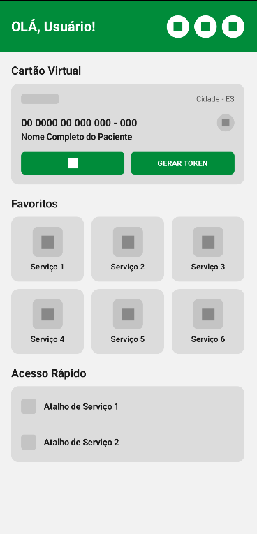
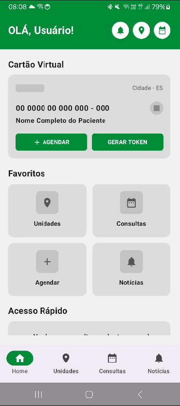
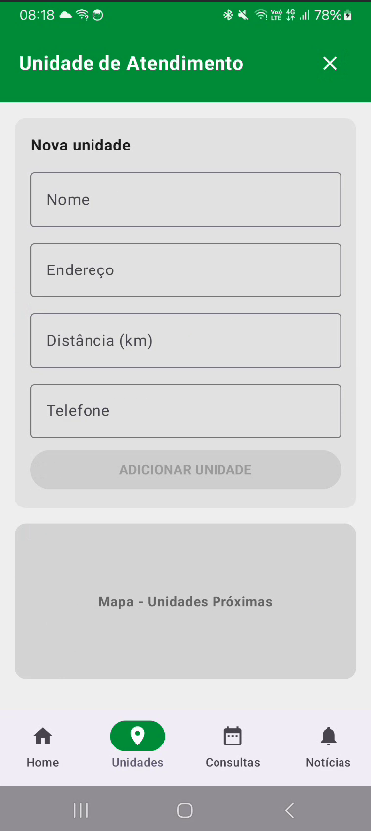
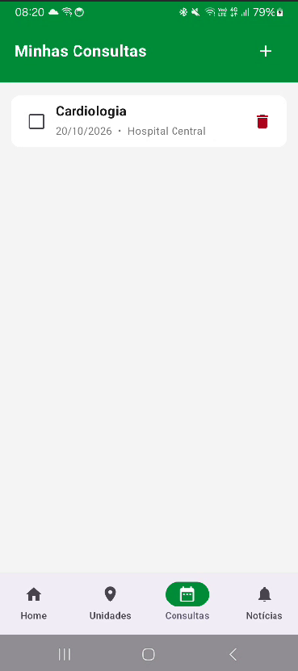
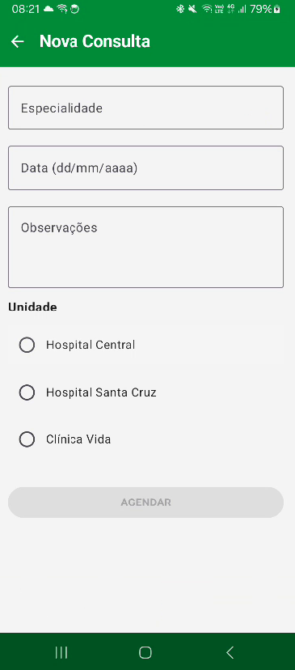
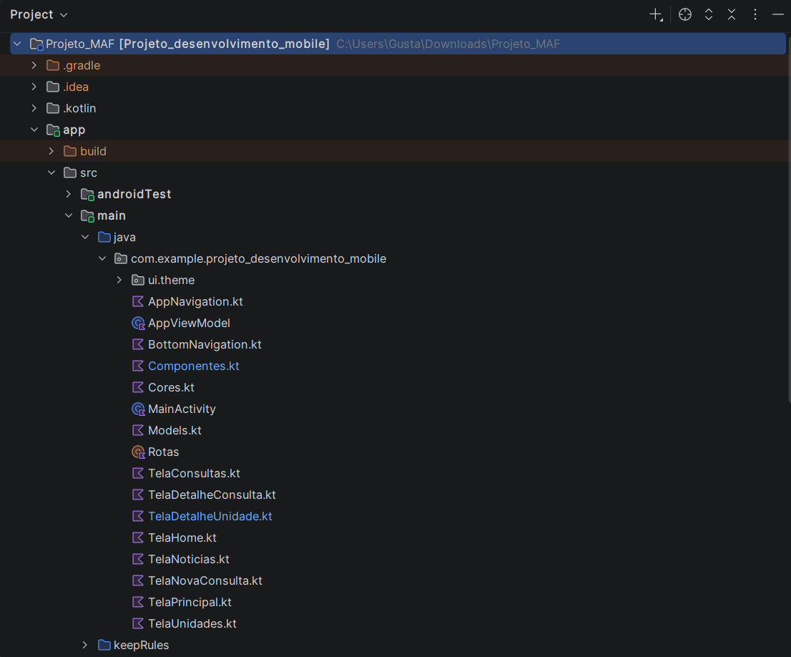
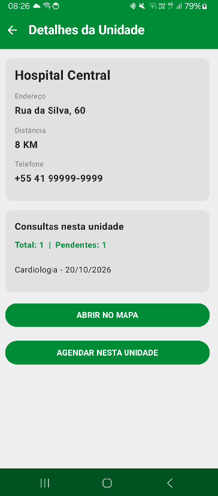
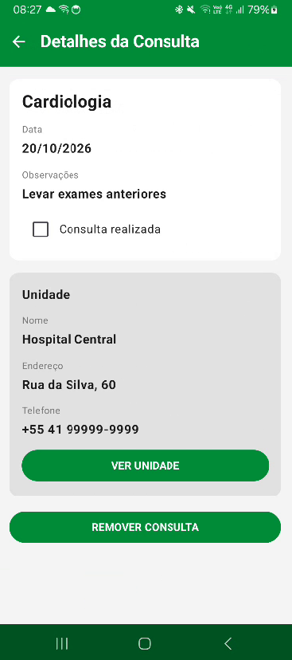

# Documentação do processo – Trabalho 2 (MAF)

Integrantes: Gustavo Purkoot Ferreira, Lucas Kirsten

---

## 1. Como estava o projeto no Trabalho 1 e o que mudou

No Trabalho 1 o app tinha 3 telas só visuais: **Home**, **Notícias** e **Unidades de Atendimento**. Os botões eram só desenhos (caixas com texto) e não faziam nada, e os dados eram fixos, como "Hospital 1, 2, 3" e "Serviço 1 a 6". Não existia navegação, e a `MainActivity` nem chamava as telas.

Para chegar no MAF, o que mudou foi:

- Adicionamos o **Navigation Compose**, com um `NavHost` central e um objeto `Rotas`.
- Criamos uma **barra de navegação inferior** com 4 abas: Home, Unidades, Consultas e Notícias.
- A lista de unidades deixou de ser fixa: agora dá para **adicionar e remover** unidades.
- Criamos uma segunda lista, a de **consultas**, também com adicionar, remover e marcar como realizada.
- Criamos telas de **detalhe** para cada lista e um **formulário** para agendar consultas.
- Os botões da Home passaram a ter função de verdade (navegar, gerar token, mostrar a próxima consulta).

📷 **Print:** telas do Trabalho 1 (antes)

📷 **Print:** Home e navegação inferior (depois)

---

## 2. Por que essas telas novas

O tema do app é saúde, então escolhemos duas coisas que se relacionam: **unidades de atendimento** e **consultas** marcadas nelas. Cada consulta guarda a unidade onde acontece, o que permite ligar as duas listas.

| Tela | O que faz | Por que escolhemos |
|---|---|---|
| Unidades (lista) | Mostra as unidades, permite adicionar, remover, ordenar por distância e ligar | Evolução da tela do Trabalho 1 |
| Detalhe da Unidade | Mostra os dados da unidade e quantas consultas há nela | Cada item da lista precisa de uma tela própria |
| Consultas (lista) | Mostra as consultas, permite marcar como realizada e remover | Segundo tipo de item do app |
| Detalhe da Consulta | Mostra a consulta e os dados da unidade dela | Liga as duas listas |
| Nova Consulta | Formulário para agendar | Forma de adicionar na segunda lista |

📷 **Print:** lista de Unidades com o formulário aberto

📷 **Print:** lista de Consultas

📷 **Print:** formulário de Nova Consulta

---

## 3. Decisões de organização do código

- **Rotas:** ficam no objeto `Rotas` (`Rotas.kt`), com as rotas como `const val`. Para as telas com argumento (`detalhe_unidade/{id}`), criamos funções como `Rotas.detalheUnidade(id)`, para não montar a string na mão em cada tela.
- **NavHost:** fica em um único arquivo, o `AppNavigation.kt`, que controla todas as 7 telas. A `TelaPrincipal` só monta o `Scaffold` com a barra de baixo e chama o `AppNavigation`.
- **Onde ficam as listas:** no `AppViewModel`, com `mutableStateListOf`. Colocamos lá para todas as telas lerem os mesmos dados. Assim uma consulta criada no formulário aparece na lista e nos detalhes. Os dados ficam só na memória, como o trabalho permite.
- **Passagem de dados:** as telas de detalhe recebem só o `id` pela rota e buscam o item no `ViewModel`, em vez de receber o objeto inteiro.
- **Barra de baixo:** aparece só nas 4 telas principais. Nos detalhes e no formulário ela some e entra a `TopAppBar` com o botão de voltar (`popBackStack`).
- **Arquivos separados:** `Models.kt` (data classes), `Componentes.kt` (itens reaproveitados, como a `TopAppBar` e o botão verde) e `Cores.kt`.

📷 **Print:** estrutura de pastas/arquivos no Android Studio

---

## 4. Complexidade extra na tela de Detalhes

Fizemos as duas telas de detalhe irem além de só mostrar os campos:

- **Detalhe da Unidade:** mostra o total de consultas e quantas estão pendentes naquela unidade. Esse número é **calculado** a partir da lista de consultas. Cada consulta listada ali abre o detalhe dela, e há um botão para agendar uma consulta já naquela unidade.
- **Detalhe da Consulta:** **combina dados das duas listas**, mostrando junto os dados da unidade onde a consulta acontece. Também tem um botão "Ver unidade", que leva ao detalhe dela, e permite marcar como realizada e remover.

Escolhemos isso porque deixa as duas listas conectadas, em vez de duas telas separadas que só repetem campos.

📷 **Print:** Detalhe da Unidade

📷 **Print:** Detalhe da Consulta

---

## 5. Dificuldades do grupo

**Ícones.** Uma das dificuldades foi usar ícones do Material (como Home, Place, Delete e o de voltar). O ícone ficava em vermelho no código mesmo depois de tentar importar, porque ele não estava disponível no projeto: era preciso adicionar a biblioteca de ícones no Gradle (`material-icons-extended`) e sincronizar o projeto, além de fazer o `import` no arquivo. Resolvemos adicionando a dependência no `build.gradle.kts` e sincronizando o Gradle, e usando o Alt+Enter para importar cada ícone.

**Mapa.** Queríamos que a tela de unidades tivesse um mapa real, no lugar do quadro cinza do Trabalho 1. Descobrimos que um mapa dentro do app exige configuração extra (dependência, permissão de internet e coordenadas de cada unidade), e que algumas opções pedem chave de API. Para não arriscar quebrar um app que já funcionava, decidimos usar uma solução mais simples: um botão "Abrir no mapa" que abre o aplicativo de mapas do celular já buscando o endereço da unidade. Os endereços de exemplo são fictícios, então o resultado no mapa é aproximado.

---