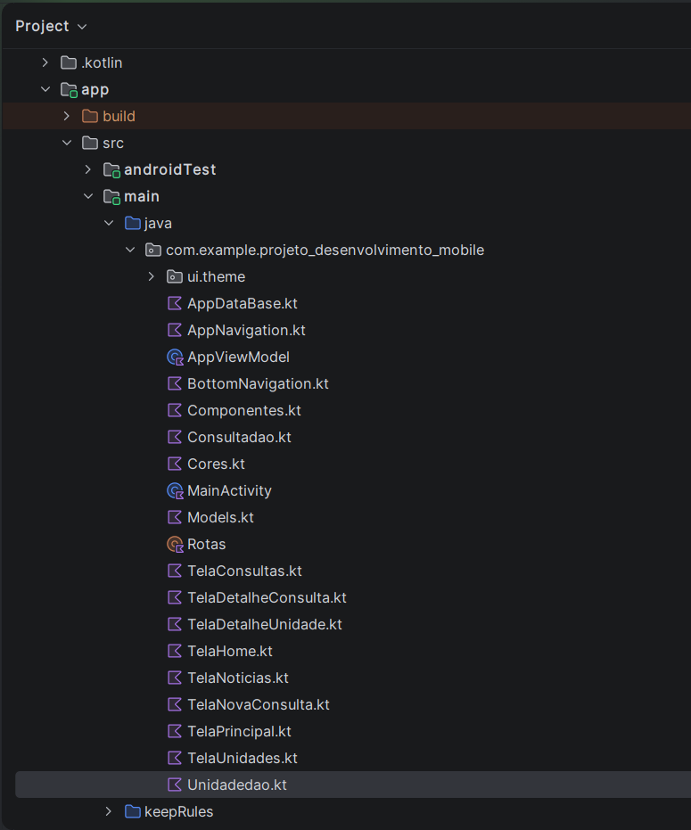
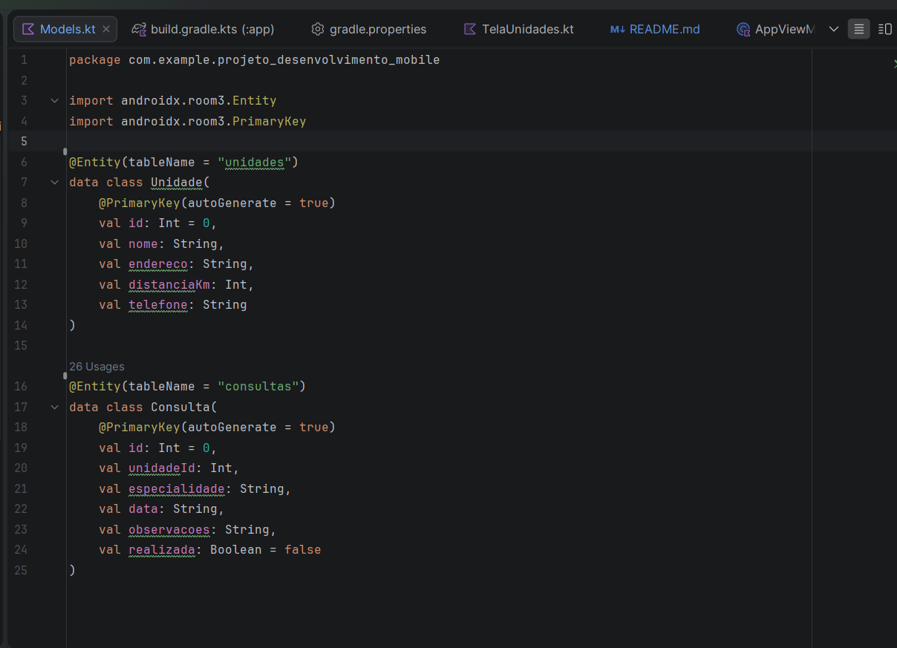
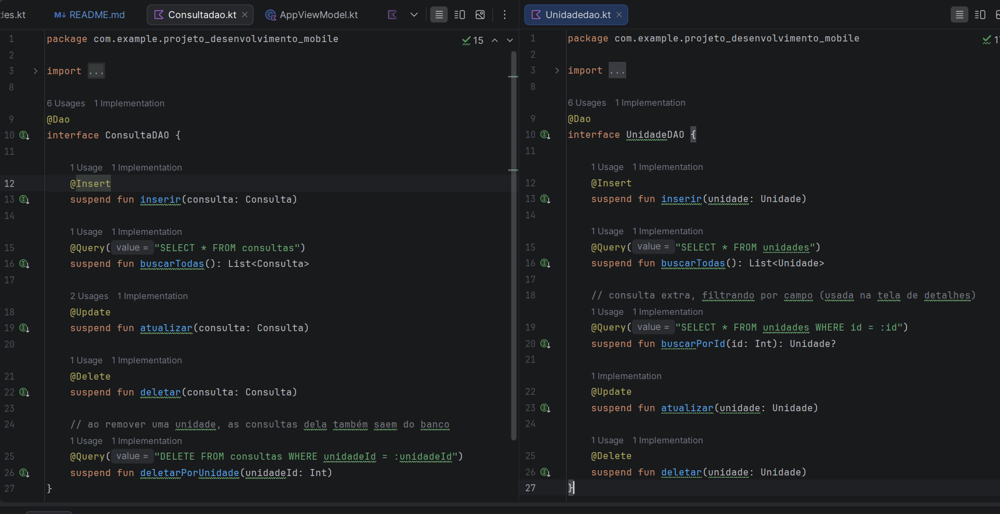
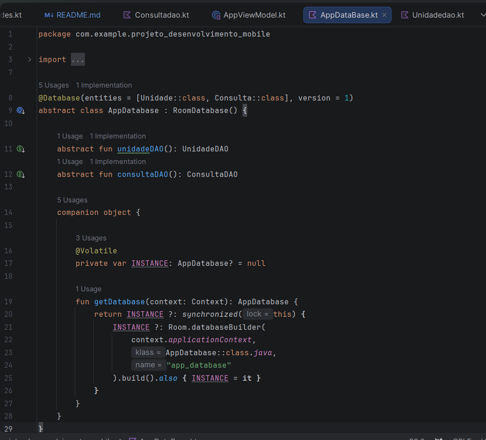

# Trabalho 3 – Persistência de Dados com Room

Integrantes: Gustavo Purkoot Ferreira, Lucas Kirsten

App de saúde com **unidades de atendimento** e **consultas**, evoluído do Trabalho 2 (MAF). Agora os dados ficam salvos no aparelho com **Room** e continuam lá depois de fechar o app.

## Como rodar o projeto

1. Clonar o repositório e abrir a pasta no Android Studio.
2. Esperar o **Sync do Gradle** terminar (o projeto usa o plugin KSP e o Room 3, `androidx.room3`).
3. Rodar em um emulador ou celular com Android 7.0 (API 24) ou superior.
4. O banco começa **vazio**: use o **+** na tela de Unidades para cadastrar unidades e o **+** na tela de Consultas para agendar.

🎥 **Vídeo geral do app funcionando:** https://drive.google.com/drive/folders/1jA9SJhdd84-jAcOe9ClGPwYar4Tpta3h?usp=sharing

---

## 1. Como estava o projeto no Trabalho 2 e o que mudou

No Trabalho 2 o app já tinha 7 telas com `NavHost`, duas listas (unidades e consultas) com adicionar e remover, formulário de nova consulta e telas de detalhe. Só que as duas listas ficavam em `mutableStateListOf` dentro do `AppViewModel`, então **tudo sumia quando o app era fechado**, e as 3 unidades e a consulta de exemplo eram escritas direto no código.

No Trabalho 3 **não criamos telas novas**. O que mudou foi o que fica por baixo:

- Adicionamos o **Room** (dependências e plugin KSP) no Gradle.
- As duas `data class` (`Unidade` e `Consulta`) viraram `@Entity`.
- Criamos um `@Dao` para cada uma e a classe `AppDatabase`.
- O `AppViewModel` deixou de guardar os dados na memória e passou a **ler e escrever no banco**, mantendo os mesmos nomes de função (`adicionarUnidade`, `removerConsulta` etc.), por isso as telas quase não mudaram.
- A **edição** passou a existir de verdade: o detalhe da consulta ganhou um campo para editar as observações, e o checkbox "realizada" também grava no banco.
- O **Detalhe da Unidade** agora busca a unidade direto no banco pelo `id` recebido na rota.

📷 **Print:** [estrutura do projeto no Android Studio com os arquivos novos]

---

## 2. Entity, DAO e Database

### Entities

| Entity | Tabela | Campos |
|---|---|---|
| `Unidade` | `unidades` | `id` (chave primária, autoincremento), `nome`, `endereco`, `distanciaKm`, `telefone` |
| `Consulta` | `consultas` | `id` (chave primária, autoincremento), `unidadeId`, `especialidade`, `data`, `observacoes`, `realizada` |

Reaproveitamos os campos que já existiam no Trabalho 2, porque eles já eram o que as telas e os formulários usavam. Só mudou o `id`, que agora é `val id: Int = 0` com `@PrimaryKey(autoGenerate = true)`: quem gera o id é o banco, não mais um contador dentro do ViewModel. A `Consulta` guarda o `unidadeId` para ligar cada consulta à unidade onde acontece.

### DAOs

Cada DAO tem os 4 métodos básicos, todos `suspend fun`: `@Insert`, `@Query("SELECT * FROM ...")`, `@Update` e `@Delete`.

- **`UnidadeDAO`:** `inserir`, `buscarTodas`, `atualizar`, `deletar` e mais `buscarPorId`.
- **`ConsultaDAO`:** `inserir`, `buscarTodas`, `atualizar`, `deletar` e mais `deletarPorUnidade`.

### Database

`AppDataBase` é uma `abstract class : RoomDatabase()` com `@Database(entities = [Unidade::class, Consulta::class], version = 1)`. Ela expõe os dois DAOs e segue o padrão **Singleton** visto em aula (`companion object` + `@Volatile` + `synchronized`), para existir uma única instância do banco no app.

📷 **Print:** código de `Models.kt` (as duas `@Entity`)

📷 **Print:** código dos dois DAOs

📷 **Print:** código de `AppDatabase.kt`

---

## 3. Decisões sobre as queries do DAO

Além dos 4 métodos básicos, criamos duas consultas extras, cada uma por um motivo do app:

- **`buscarPorId`** (`SELECT * FROM unidades WHERE id = :id`): o Detalhe da Unidade recebe só o `id` pela navegação e usa essa consulta para buscar a unidade certa no banco, em vez de receber o objeto pronto. Retorna `Unidade?`, porque o id pode não existir.
- **`deletarPorUnidade`** (`DELETE FROM consultas WHERE unidadeId = :unidadeId`): no Trabalho 2, remover uma unidade já removia as consultas dela da lista. Mantivemos esse comportamento no banco com uma query só, assim não sobra consulta apontando para uma unidade que não existe mais.

---

## 4. Como o CRUD funciona agora

Toda operação de banco roda dentro de `CoroutineScope(Dispatchers.IO).launch { ... }` com `try/catch` e `Log.e(...)`, como no exemplo de aula, para a interface não travar.

| Operação | Onde acontece | O que chama |
|---|---|---|
| **Buscar** | Ao entrar nas telas de Unidades e Consultas (`LaunchedEffect(Unit)`) | `buscarTodas()` |
| **Inserir** | Formulário de unidade e formulário de Nova Consulta | `inserir(...)` |
| **Atualizar** | Detalhe da Consulta: salvar observações e marcar como realizada | `atualizar(...)` |
| **Remover** | Lixeira nas listas e botão "Remover consulta" | `deletar(...)` |
| **Buscar por id** | Detalhe da Unidade | `buscarPorId(id)` |

Depois de cada escrita, o ViewModel lê as listas de novo do banco, então a tela sempre mostra o que está salvo de verdade.

---

## 5. Teste de persistência

🎥 **Vídeo do teste:** https://drive.google.com/drive/folders/1jA9SJhdd84-jAcOe9ClGPwYar4Tpta3h?usp=sharing

---

## 6. Dificuldades na migração de `mutableStateListOf` para Room

- **Os dados deixaram de ser uma lista mutável:** as telas usavam `viewModel.unidades` e `viewModel.consultas` como `mutableStateListOf`. Agora são `List` guardadas em um `mutableStateOf`, e a tela atualiza quando o ViewModel lê o banco de novo. Como as listas continuaram sendo `List`, quase nenhuma tela precisou mudar.
- **O `id` passou a ser do banco:** antes o ViewModel tinha contadores (`proximoIdUnidade`, `proximoIdConsulta`). Com `autoGenerate = true` esses contadores foram removidos, e as entidades são criadas com `id = 0`.
- **Os `@Preview` quebraram:** eles criavam `AppViewModel()` sem argumentos, mas agora o ViewModel precisa de um `Application` para abrir o banco. Removemos os 3 previews.
- **O banco começa vazio:** os dados de exemplo que ficavam escritos no código sumiram, então para testar é preciso cadastrar itens pelo app.
- **Operação de banco fora da thread principal:** como o DAO usa `suspend fun`, tudo precisou ir para dentro de uma Coroutine em `Dispatchers.IO`, com `try/catch` para não derrubar o app se o banco falhar.
- **Detalhe da Unidade assíncrono:** buscar no banco não é instantâneo, então a tela guarda a unidade em um estado e preenche quando o `buscarPorId` volta.
- Tivemos um pouco de dificuldade para configurar as dependências necessárias para utilizar o Room e fazer as importações no projeto. Depois de ajustar as configurações e organizar os arquivos, conseguimos executar o aplicativo normalmente.

---

## 7. Dificuldades dos integrantes

Tivemos um pouco de dificuldade para fazer as importações necessárias para utilizar o banco de dados Room no projeto.
